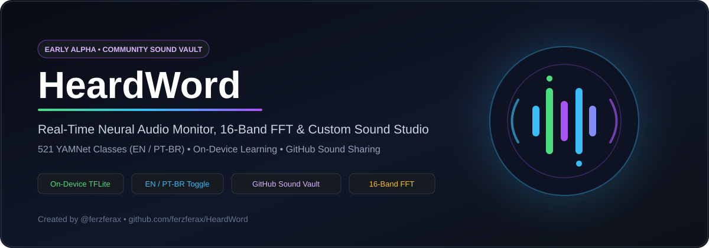
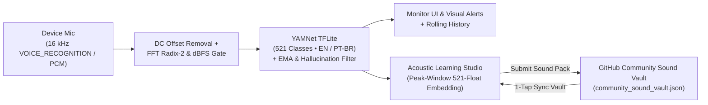

<p align="center">
  
</p>

<p align="center">
  
  
  
  
  
</p>

# 🎙️ HeardWord — Neural Audio Monitor & Community Sound Vault

**HeardWord** (provisional name) is a lightweight, privacy-conscious Android acoustic recognition app built by **[@ferzferax](https://github.com/ferzferax)** using **Google YAMNet (TensorFlow Lite)** and a real-time **16-band Radix-2 FFT spectrum analyzer**.

Originally split out from a multi-sensor prototype, HeardWord focuses strictly on **real-time sound classification**, **on-device custom sound teaching**, and **community sound sharing through Git & GitHub**.

---

> [!IMPORTANT]
> **Early-Stage Open-Source Project Notice**  
> This is an **initial / early-stage experimental project** with plenty of room to grow, refine, and improve! I decided to open-source it publicly so anyone interested can **inspect the code, install and test the APK on real Android devices, contribute bug fixes/features, and help expand the shared acoustic database on GitHub.**

> [!NOTE]
> **Privacy-First Sound Sharing (Why Sharing via GitHub is Safe)**  
> When you teach HeardWord a custom sound inside the **Studio** tab, the app **never stores or uploads raw audio recordings**. Instead, it computes an anonymous **521-dimensional floating-point neural signature (embedding vector)**. You can share that JSON profile directly to this GitHub repository so other users can sync and recognize new sounds without exposing personal audio.

---

## 🏗️ How HeardWord & the GitHub Sound Vault Work



---

## ✨ Key Features (`v0.2.0-alpha`)

- **Dual Acoustic & Neural Noise Gate:** Strict `dBFS` threshold gating + YAMNet `"Silence"` dominance check keeps live detection clean in quiet environments instead of hallucinating low-confidence thermal mic hiss.
- **EMA Temporal Smoothing & Hallucination Filter:** Smooths transient frame jitter across consecutive windows (with fast impulse bypass for critical alarms/impacts) and filters esoteric non-urban microphone-noise artifacts (`Snake`, `Rattle`, `Hiss`, etc.).
- **Real-Time Neural Classification (521 Classes):** On-device TensorFlow Lite inference (`yamnet.tflite`) with descending confidence ranking (`>= 25%` baseline) and critical sound detection (sirens, alarms, glass shatter, dog barking, speech, impacts).
- **Instant Bilingual UI & Classifier Toggle (`🌐 EN / PT`):** Starts in **English** by default and lets you switch all screens **and all 521 YAMNet labels** between **English** and **Portuguese (PT-BR)** instantly from the top bar or Modes tab.
- **16-Band Radix-2 FFT Spectrum Analyzer:** Live acoustic dashboard showing RMS dBFS, Peak dBFS, and dominant frequency (Hz) from `30 Hz` to `8 kHz`.
- **Acoustic Learning Studio:** Record a 2-second sample (with automatic highest-energy 1-second slice selection) to teach HeardWord any custom household/workplace sound using cosine similarity matching.
- **Git / GitHub Community Sound Sharing:**
  - **Export / Import JSON:** Copy or paste `heardword-sound-pack/v1` profiles locally.
  - **🚀 Submit Sound Pack to GitHub:** Automatically copies your trained sound JSON and opens the GitHub submission template so contributors can grow the global catalog.
  - **☁️ Sync Vault from GitHub:** Pulls `community_sounds/community_sound_vault.json` directly from the `main` branch into your device.
- **Minimal Permissions & Signed Release Build:** Uses only microphone/foreground audio permissions (`RECORD_AUDIO`, `FOREGROUND_SERVICE_MICROPHONE`, `POST_NOTIFICATIONS`, `VIBRATE`, `WAKE_LOCK`) plus `INTERNET` strictly for the optional GitHub Sound Vault sync. *(All Sonar / Bluetooth / Location / Wi-Fi permissions were completely removed during separation).* See [`CHANGELOG.md`](CHANGELOG.md) for full release notes.

---

## 🚀 Step-by-Step Guide

### Option A: Test the Pre-Built APK on Android

1. Download **`HeardWord.apk`** from the [GitHub Releases](https://github.com/ferzferax/HeardWord/releases) page.
2. Install on your Android device (`Android 8.0+ / API 26+`), or via ADB:
   ```bash
   adb install -r HeardWord.apk
   ```
3. Grant **Microphone** permission when prompted (and **Notifications** on Android 13+ so the foreground monitoring indicator works).
4. **Explore the Tabs:**
   - **Monitor:** Tap **START** to see live dBFS levels, the 16-band FFT spectrum, top YAMNet sound classes, visual alert badges, and the rolling **History** dialog.
   - **Studio:** Type a name (e.g., `Doorbell`), tap **Record & Learn Sound**, then test **Export Bank**, **Submit Sound Pack to GitHub**, or **Sync Vault from GitHub**.
   - **Modes:** Switch language (`English` / `Português (BR)`), choose an acoustic profile (*Adaptive*, *Night*, *Normal*, *Noisy*), fine-tune the dBFS threshold slider, and toggle critical sound vibration.
   - **Guide:** Quick acoustic reference for dBFS levels, YAMNet inference, and embedding-based sharing.
   - **Top Bar `🌐 EN → PT`:** Switch between English and Portuguese anytime.

---

### Option B: Build from Source (Android Studio / Gradle)

> [!TIP]
> **Requirements:** JDK 17 and Android SDK (Compile SDK 36, Min SDK 26).

1. **Clone the Repository:**
   ```bash
   git clone https://github.com/ferzferax/HeardWord.git
   cd HeardWord
   ```
2. **Configure Local SDK Path:**
   Create `local.properties` in the project root pointing to your Android SDK:
   ```properties
   sdk.dir=C\:\\Users\\YOUR_USER\\AppData\\Local\\Android\\Sdk
   ```
3. **Compile & Install via Gradle:**
   ```bash
   ./gradlew assembleDebug
   adb install -r app/build/outputs/apk/debug/app-debug.apk
   ```

---

## 🤝 Contributing Sounds via Git & GitHub

Want to help build a rich, open database of real-world sound signatures?
1. Record a new sound in **HeardWord Studio**.
2. Tap **Submit Sound Pack to GitHub** (which opens our [Sound Pack Submission Issue](https://github.com/ferzferax/HeardWord/issues/new?template=sound_pack_submission.md)) **OR** fork this repository and add your embedding JSON into [`community_sounds/community_sound_vault.json`](community_sounds/community_sound_vault.json) via Pull Request.

See [`CONTRIBUTING.md`](CONTRIBUTING.md) for detailed instructions.

---

## 📂 Repository Structure

```text
HeardWord/
├── .github/ISSUE_TEMPLATE/
│   ├── bug_report.md
│   └── sound_pack_submission.md      # Template for community sound vault submissions
├── app/src/main/
│   ├── AndroidManifest.xml           # Audio & optional GitHub sync permissions only
│   ├── assets/
│   │   ├── yamnet.tflite             # Google YAMNet TFLite model
│   │   ├── yamnet_classes_en.json    # 521 official English labels
│   │   └── yamnet_classes_pt.json    # 521 Portuguese (PT-BR) labels
│   ├── kotlin/com/example/audiomonitor/
│   │   ├── MainActivity.kt           # 4-tab UI + top bar EN/PT toggle
│   │   ├── audio/AudioProcessor.kt   # 16-band Radix-2 FFT + dBFS metrics
│   │   ├── data/                     # State models, prefs & GitHub Vault sync
│   │   ├── ml/YamnetClassifier.kt    # TFLite inference + 521-dim cosine matcher
│   │   ├── service/AudioMonitorService.kt
│   │   └── ui/                       # Monitor, Studio, Modes & Guide screens
│   └── res/drawable/                 # Custom adaptive vector icon for HeardWord
├── assets/heardword_banner.svg
├── community_sounds/
│   └── community_sound_vault.json    # Shared community acoustic embeddings
├── CHANGELOG.md
├── CONTRIBUTING.md
├── LICENSE                           # MIT License
└── README.md
```

---

## 🙏 Credits & Open-Source Stack

- **Creator & Maintainer:** [@ferzferax](https://github.com/ferzferax)
- **Neural Audio Model:** [Google YAMNet / AudioSet (TensorFlow Lite)](https://tfhub.dev/google/yamnet/1) — 521 audio event classes.
- **UI Toolkit:** Jetpack Compose & Material 3.

---

## 📄 License

Released under the **MIT License** — see [`LICENSE`](LICENSE) for details.
